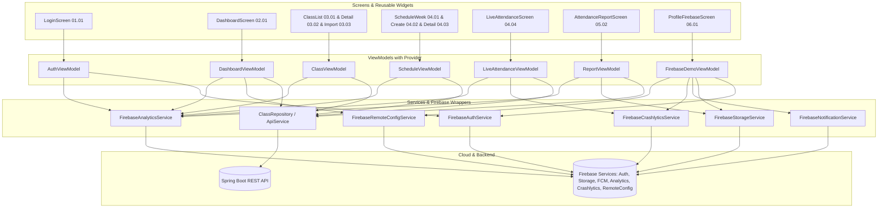
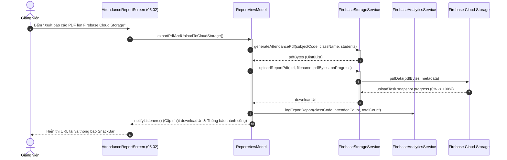

# Architecture & Layering Specification (Tài Liệu Kiến Trúc) — Lab 3

Hệ thống được xây dựng theo mô hình **MVVM (Model - View - ViewModel)** kết hợp với thư viện quản lý trạng thái **Provider**, tuân thủ nguyên tắc phụ thuộc một chiều (Dependencies point downwards only).

---

## 1. Cấu trúc thư mục dự án (`lib/`)

```
lib/
├── firebase/         # Triển khai các dịch vụ Firebase (Auth, Storage, FCM, Analytics, Crashlytics, Remote Config)
├── models/           # Các lớp mô hình dữ liệu Dart thuần túy (UserModel, ClassModel, SessionModel, UiState)
├── screens/          # Tầng View chứa toàn bộ 10 màn hình Figma và màn hình Firebase Demo
│   ├── attendance/   # Màn hình phiên điểm danh trực tiếp & mã QR (04.04)
│   ├── auth/         # Màn hình đăng nhập tài khoản Google (01.01)
│   ├── classes/      # Màn hình danh sách lớp (03.01), chi tiết lớp (03.02), nhập sinh viên (03.03)
│   ├── dashboard/    # Màn hình tổng quan giảng dạy (02.01)
│   ├── profile/      # Màn hình hồ sơ giảng viên & khu vực chấm điểm Firebase Demo Area
│   ├── reports/      # Màn hình báo cáo điểm danh & xuất PDF Cloud Storage (05.02)
│   └── schedule/     # Màn hình lịch tuần (04.01), tạo lịch (04.02), chi tiết tiết (04.03)
├── services/         # Tầng Repository và API Client giao tiếp backend Spring Boot
├── theme/            # Hệ thống Design Tokens từ Figma (Màu sắc, Typography, Kích thước bo góc)
├── utils/            # Hằng số và hàm tiện ích dùng chung
├── widgets/          # Thư viện widget tái sử dụng (App Bar, Buttons, Cards, Status Pills, State Views)
└── main.dart         # Điểm khởi động ứng dụng, thiết lập MultiProvider và điều hướng auth state
```

---

## 2. Sơ đồ các tầng kiến trúc (MVVM Layer Diagram)



---

## 3. Sequence Diagram luồng nghiệp vụ hoàn chỉnh (Báo cáo điểm danh $\rightarrow$ Xuất PDF $\rightarrow$ Upload Firebase Storage)



---

## 4. Bảng ánh xạ ViewModel và các Service được Inject

| Tên ViewModel | Các Service được tiêm phụ thuộc (Injected Services) | Trách nhiệm chính |
|---|---|---|
| `AuthViewModel` | `FirebaseAuthService`, `FirebaseAnalyticsService` | Quản lý phiên đăng nhập Google, định tuyến auth state, xóa dữ liệu đệm khi đăng xuất |
| `DashboardViewModel` | `ClassRepository`, `FirebaseRemoteConfigService`, `FirebaseAnalyticsService` | Lấy dữ liệu tiết hôm nay, tiết sắp tới, tự động đồng bộ theo chu kỳ Remote Config |
| `ClassViewModel` | `ClassRepository`, `FirebaseAnalyticsService` | Quản lý danh sách lớp (03.01), chi tiết lớp (03.02), tìm kiếm và quy trình nhập từ Sheet 3 bước (03.03) |
| `ScheduleViewModel` | `ClassRepository`, `FirebaseAnalyticsService` | Quản lý lịch tuần (04.01), xếp lịch mới (04.02), chi tiết trước giờ điểm danh (04.03) |
| `LiveAttendanceViewModel` | `ClassRepository`, `FirebaseCrashlyticsService`, `FirebaseAnalyticsService` | Bộ đếm thời gian QR (45s), thống kê thời gian thực 4 ô, lọc danh sách SV, chốt vắng (04.04) |
| `ReportViewModel` | `ClassRepository`, `FirebaseStorageService`, `FirebaseAuthService`, `FirebaseAnalyticsService` | Báo cáo điểm danh (05.02), chỉnh sửa trạng thái điểm danh, xuất PDF lên Cloud Storage |
| `FirebaseDemoViewModel` | Cả 6 dịch vụ Firebase (`Auth`, `Storage`, `FCM`, `Analytics`, `Crashlytics`, `RemoteConfig`) | Phục vụ trình diễn và chấm điểm trực tiếp toàn bộ 6 dịch vụ đám mây theo yêu cầu Lab 3 |
